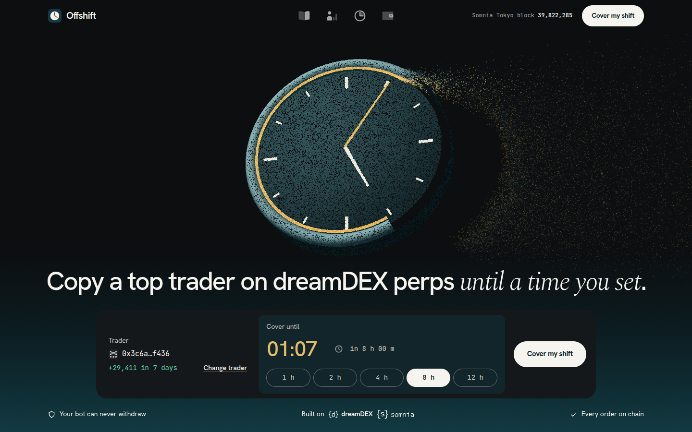
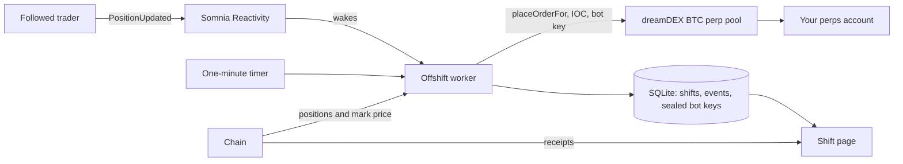
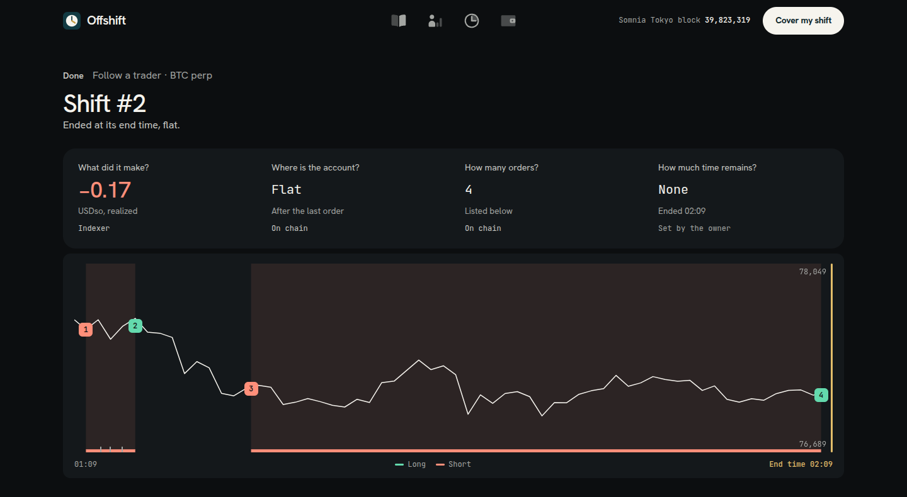
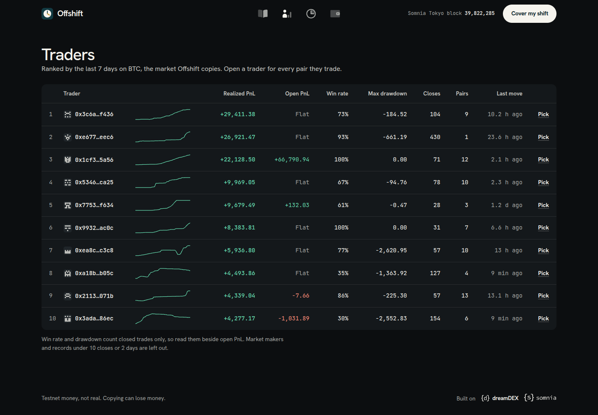
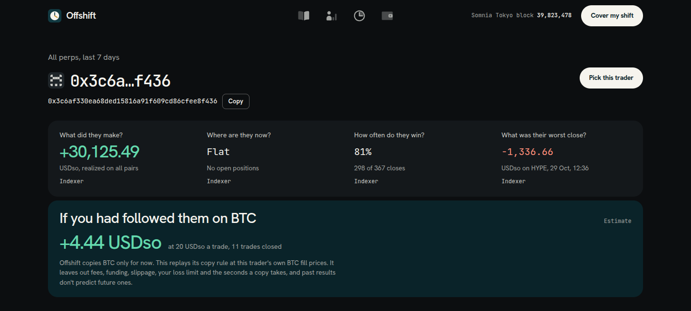

<div align="center">


# Offshift

**Pick a trader to cover your perps account until a time you set.**<br>
Offshift copies their trades within your limits, closes you out at the end, and hands you every fill.

[How it works](#how-it-works) · [On-chain record](#on-chain-record) · [Security](#security-and-privacy) · [Limits](#limits) · [Quickstart](#quickstart) · [API](#api)


</div>



A position doesn't stop moving when you go to sleep. dreamDEX lets a linked bot trade for your account, and Offshift is that bot with an end time. Choose a trader from the board and the time you'll be back. Offshift places their trades at your size, stops at your loss limit, and leaves you flat at the end, with every order listed on one page.

> [!IMPORTANT]
> Offshift runs on Somnia Tokyo testnet with testnet USDso. Copying can lose money, and exits run only while Offshift is running.

## Who it's for

Perps traders on dreamDEX who go offline while they hold a position or want exposure, and would rather have someone cover the account until a set time than leave it unattended or keep their own bot running.

## Highlights

- **An end time on every shift.** Set it from 15 minutes to 24 hours ahead. When it arrives, Offshift closes you out to flat.
- **Your size, the trader's side.** A fixed 5 to 1,000 USDso per trade, not the trader's own ratio.
- **No late entries.** An entry is skipped once the price is more than 0.5% past the trader's entry. Exits always copy.
- **A loss limit on every shift.** At least 1 USDso. Reaching it ends the shift and closes the position.
- **Wakes on the trader's move.** Somnia Reactivity pushes each position change, with a one-minute timer behind it. Live copies were confirmed 6.3 to 8.2 seconds after the event.
- **A bot that can't withdraw.** It trades for your account and can never move money out. Your USDso stays in your own dreamDEX account.
- **No sign-up.** Offshift asks for your public address, never a private key or a wallet connection.
- **Traders you can read first.** Ranked over 7 days of BTC closes, with market makers left out, and a page for each trader across every perp market.
- **Safe across a restart.** Every decision starts from the on-chain position, so a restart can't place a duplicate order.

## Built with

| | Used for |
|---|---|
| **dreamDEX perps** | The BTC perp market. Orders go in through `placeOrderFor`, from a bot the owner links on dreamDEX. |
| **Somnia Reactivity** | `somnia_watch` pushes the margin bank's `PositionUpdated` events for the BTC pool over WebSocket. |
| **Markets SDK** | `@somnia-chain/markets-sdk`: positions, mark prices, candles, access checks and indexer history. |

Also used: viem, Node.js with `node:http` and `node:sqlite`. There is no web framework and no build step.

## How it works



1. **Pick.** Choose a trader from the board and an end time.
2. **Add the bot.** Paste your dreamDEX address and Offshift makes a bot for it. Add that bot in dreamDEX's Link a bot screen, which can send it gas in the same step. Offshift checks access, gas and margin every 5 seconds and moves on by itself. A shift needs 5 USDso in your perps account and about 0.5 STT on the bot.
3. **Set your limits.** Size per trade and loss limit, then review and start. The review shows what the trader holds now, and whether your first order goes in at the start or waits for their next move.
4. **Copy.** Each pass reads your position and the trader's from the chain, then closes the gap with one immediate-or-cancel order limited to 0.5% through the mark. The Reactivity event only wakes the worker; the chain read decides. If nothing fills, it tries again in 10 seconds.
5. **End.** At the end time or the loss limit, the worker stops copying and brings you to flat. If you remove the bot on dreamDEX, the shift stops.
6. **Hand over.** The shift page shows the result, a BTC chart of what you held, every order with its transaction and block, and **Run again**.





Each trader has a page across all perp markets, with an estimate of what following them on BTC would have made.



## On-chain record

Every shift so far ran on the project's test account. All 18 orders and both setup transactions were read back from the RPC, and all of them succeeded.

| | |
|---|---|
| Test account | `0x78fD47fb67a59E0b535b8a8D69D3eB3d7538584E` |
| Bots | `0x65A4e65092f845477da76EB42Fea71bC9a31F504`, `0x8Aa89972617D75E671Cb54532c03f992153f8D43`, `0xE377B45CA9426E5BB240E5Cd142F221fA0c2910A` |
| BTC perp pool | `0x4181dd08e73bbcdd1ba3e615a18f6abd941b94c0` |
| Shifts | 16, all finished: 15 following a trader, 1 on the preset strategy |
| Orders | 18 filled at 20 USDso a trade |
| Entries skipped | 16, with the price past the 0.5% tolerance |

| Shift | What happened | Transactions |
|---|---|---|
| Setup | A linked bot placed a resting BTC bid for the owner and cancelled it, leaving no collateral locked | `0x149b9ae7…178a`, `0xcaa653ca…456f` |
| 1 | Sold on the preset strategy. The worker was killed and restarted with no duplicate order, then the shift bought back to flat | `0x0edfb3d5…05ed`, `0xed86f0bd…4aa9` |
| 2 | First copied trade, then a copy 8.2 s after the Reactivity event. Ended flat at its end time, −0.17 USDso | `0xf5e42f95…6dfa`, `0xb19d75c4…242e` |
| 4 | Followed a short with the mark 3.4% past the trader's entry, so it placed no order | none |
| 11 | Closed flat at its end time | `0xbb0d25dd…0a8e`, `0x05942a32…a9f9` |
| 13 | Copied an open and its close, 6.3 s and 8.0 s after each event | `0x8eae7ce9…f2c9`, `0xe41ce851…bff0` |
| 14 | Loss-limit exit. The limit was forced to −1 in the database to test the path | `0x575fcf5c…0f3d`, `0x9b246f5b…68b1` |
| 15 | Fresh clone of this repo, run through the web app. Ended early with End shift now | `0x12471f43…50be`, `0x9d216e89…86b7` |
| 16 | Same clone. Closed flat by itself about 20 s after its end time | `0xe0bd8c54…fb1b`, `0xca350434…938c` |

Read any of them from the RPC:

```bash
cast receipt 0xb19d75c4422209d9be65588ea4fa739d2b374fe7324062793d90684b1c39242e --rpc-url https://api.hideki2.infra.testnet.somnia.network
```

## Security and privacy

- **Owner keys never reach Offshift.** The app asks only for a public address.
- **Bot keys are sealed.** Each is generated by Offshift and encrypted at rest with AES-256-GCM under `OFFSHIFT_SECRET`. A linked bot can trade for its owner and cannot withdraw.
- **Only the creating browser controls a shift.** Each bot comes with a random secret kept in that browser's `localStorage`, stored only as a hash on the server. Starting or ending a shift needs it. Knowing an address isn't enough.
- **Shift pages are private links.** Each sits at a random 128-bit link, and the Shifts page lists only accounts saved in your browser. The orders themselves are public on chain.
- **You can cut it off.** Remove the bot on dreamDEX at any time, and the next pass ends the shift.

## Limits

- Offshift copies BTC only. Other markets appear on trader pages but aren't copied.
- One running shift per account, because two would trade against each other.
- Exits run only while Offshift is running.
- If you remove the bot during a shift, any open position stays open for you to close on dreamDEX.
- The loss limit ends a shift but can't promise an exact exit. It counts any trades you make by hand on BTC during the shift.
- A remainder below the market's minimum order can't be closed by any order. The shift page reports it.
- The estimate on a trader page leaves out fees, funding, slippage, the loss limit and copy delay. Past results don't predict future ones.

## Quickstart

Requires Node.js 22.

```bash
git clone https://github.com/Timidan/offshift && cd offshift
npm ci
echo "OFFSHIFT_SECRET=$(openssl rand -hex 32)" > .env
npm start        # http://localhost:8787
npm test         # strategy and trader insight checks
```

On a fresh database the first load of the trader board takes about 5 minutes, and the first traders appear after about 3. After that it refreshes every 5 minutes.

Keep `OFFSHIFT_SECRET` safe: without it, the stored bot keys can't be read.

## Configuration

| Variable | Default | Purpose |
|---|---|---|
| `OFFSHIFT_SECRET` | none, required | 32 bytes of hex that seal bot keys at rest |
| `OFFSHIFT_DB` | `offshift.sqlite` | Path to the SQLite file |
| `PORT` | `8787` | Web port |
| `OWNER` · `OWNER_PRIVATE_KEY` · `BOT_PRIVATE_KEY` | none | Used only by the test-account scripts in `scripts/`, never by the app |

## Pages

| Route | Shows |
|---|---|
| `/` | Trader, end time and Cover my shift, with a real shift below |
| `/how` | How it works and frequently asked questions |
| `/traders` | The ranked board |
| `/trader/:address` | One trader across every perp market |
| `/accounts` · `/accounts/new` | Accounts saved in this browser |
| `/cover` | Shift setup, one step at a time |
| `/shifts` | Shifts from accounts saved in this browser |
| `/shift/:link` | One shift, live or finished |

## API

| Route | Body | Returns |
|---|---|---|
| `POST /api/bots` | `{ owner }` | A new bot's address and secret |
| `GET /api/link/:bot` | | Access, gas, margin and running shifts for a bot |
| `POST /api/shifts` | `{ bot, secret, trader, until, size, loss }` | The new shift's link |
| `POST /api/shifts/mine` | `{ bots: [{ bot, secret }] }` | Those bots' shifts, as HTML |
| `POST /api/shifts/:id/stop` | `{ secret }` | Ends the shift now |

## Command line

```bash
npm run cli -- bot <owner> [ENV_VAR]                         # new bot; ENV_VAR imports an existing key
npm run cli -- start <bot> <hours> <usdso> [trader|-] [loss] # - runs the preset strategy
npm run cli -- stop <id>
npm run cli -- list
npm run cli -- show <id>
```

A shift with no trader runs the preset strategy, a BTC trend rule: long while the 10-minute average of 1-minute closes is above the 30-minute average, short while below, with a 0.05% band and a 1.5% stop loss.

## Project structure

```
src/
  web.mjs        pages, API and the board refresh; importing the worker starts it
  worker.mjs     the shift loop, Reactivity watch and order placement
  strategy.mjs   follow rule, preset strategy and follow estimate, as pure functions
  board.mjs      trader ranking from indexed closes
  insight.mjs    what a trader's position changes say about them
  store.mjs      SQLite: shifts, events and sealed bot keys
  cli.mjs        operator commands
  *.test.mjs     checks for the strategy and trader insight
  dial.js        the home page dial
  clip.js        plays the setup clips
  style.css      every page's styles
  clips/         short clips of the real dreamDEX screens, shown during setup
  icons/ logos/  menu icons, and the dreamDEX and Somnia marks
scripts/         test-account setup and link checks
evidence/        saved runs of the first bot order and the first shift
docs/            logo and screenshots
```
